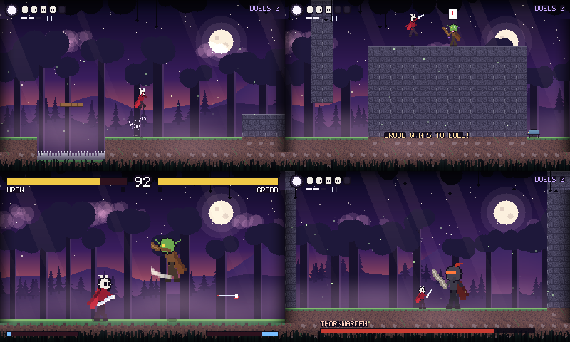

# ge: a platformer + fighting-game engine (desktop and Nintendo 3DS)

A C99 engine for **Silksong-style action platformers** in which some enemies challenge you to a **Street Fighter-style duel**. When a duelist spots you, the screen flashes and shutters like a Pokémon trainer battle, and the game becomes a 1v1 fighting game with its own controls. Win, and you're back in the forest where you left off.



*The included demo, "Gloamwood". Clockwise from top left: exploring (spike pit, silk-ring double jump), a duelist spotting you on the plateau, the boss, a duel in progress. Every pixel is drawn in code; there are no art files.*

## Quick start

```sh
cmake -S . -B build && cmake --build build -j
./build/demo                       # windowed (needs SDL2)
./build/demo --autoplay            # a scripted bot plays it, duels included
./build/demo --warp 150            # start at a column (150 = just before the boss)
ctest --test-dir build             # 161 checks, no window needed
./build/demo_headless --autoplay --frames 3000 --dump-every 300 --dump-dir shots   # PNGs, no display
```

## Controls

Buttons are named by position on a 3DS (A right, B bottom, X top, Y left). On a desktop gamepad the same positions apply.

| Overworld | 3DS / pad | Keyboard |
|---|---|---|
| Move · aim up / down | D-pad / stick | arrows or WASD |
| Jump (again in the air = double jump; jump off walls) | B | Z or Space |
| Needle slash · **up** + slash · **down** + slash in the air = pogo bounce | Y | X or J |
| Dash (also in the air, invulnerable) | R | E or O |
| Throw needle (3 charges, they refill) | X | V or I |
| Silk spin (costs 1 silk segment) | A | C or L |
| Heal 2 masks (hold, costs 1 silk segment) | L | Q or U |
| Rest at a bench: full health + respawn point | Up | Up |

| Duel (fighting game) | 3DS / pad | Keyboard |
|---|---|---|
| Walk · jump (up) · crouch (down) · holding back also blocks, at the right height (back = high, down-back = low) | D-pad | arrows |
| Break a throw (about 0.25 s after the grab) | Y + X | X + V |
| **Guard**: blocks every height (only throws beat it); you stand still | L (hold) | Q or U |
| **Dash** (hold back for a backdash) | R | E or O |
| Light · Medium · Heavy | Y · X · A | X · V · C |
| Sword thrust: slow, longest reach (down = low, also in the air) | B | Z |
| Super (full meter) | A + B together | C + Z |
| Throw: Light + Medium together, up close | Y + X | X + V |
| Specials: ↓↘→ + attack (projectile), →↓↘ + attack (rising anti-air), ↓↙← + M/H (rush), →→ dash, ←← backdash | | |

## What's in the game

**Overworld.** Masks for health, a silk spool filled by landing hits, and needle tools. Slash in three directions, pogo off enemies, spikes and enemy shots, wall-slide and wall-jump up a shaft, double-jump, air-dash. Crawlers, swooping bats, spitting plants and club-wielding grunts all hurt on contact and can be cut down. Spikes cost a mask and drop you back on safe ground. Benches heal you and set your respawn point; resting at one (or dying) brings the ordinary enemies back, as in Hollow Knight, while beaten duelists and the boss stay beaten. **Difficulty** (dev menu, saved, easy by default) changes masks (8 / 6 / 4), whether spikes cost a mask, how sharp and how hard-hitting duelists are, and the boss's health; the Paragon is the same on every setting.

**Duelists** (purple wisps around them) stand guard and turn to look around. If one sees you, a "!" pops up, the screen flashes three times, and the duelist's own animated pattern floods out from where they stand in a wave of diamonds (EarthBound-style: palette cycling plus rippling rows), then breaks up again to show the duel in the forest. Only the Paragon fights inside its pattern. Slashing one first gets you a first-strike bonus: it starts the duel at 85% health. Win, and your masks and silk refill. Lose, and you wake up at the last bench. There are four duelists, and the last one is best-of-three.

**Duels** are a full fighting game. Each fighter has standing, crouching and jumping light/medium/heavy attacks, an overhead, a low sweep that knocks down, a projectile, a rising anti-air with invulnerability, a rush, a throw (which can be teched: Y+X as you are grabbed, or on easy and normal simply a tap of L) and a super. Holding back blocks by the classic rules (lows crouching, overheads and jump-ins standing); the L guard blocks every height but roots you and loses to throws. Attack buttons pressed a few frames early are buffered. For the player, the duel names what got through ("LOW! HOLD DOWN-BACK"), marks low and high attacks with an arrow while they wind up, and draws a blue shield while you block. There's chip damage, light → medium → heavy → special cancels, damage scaling, juggles with a limit, knockdowns, rounds and a 99-second clock. The goblin hits hard and slow; the moth fencer is quick with long reach. Both come from one move list with different tuning.

**The final boss, the Paragon.** Past Thornwarden's far door is a long hall with a bench and one more fighter, built to be *your* opponent: it watches every duel you fight and learns what you do (which attacks, from what range, how you block, how you answer jump-ins and projectiles, whether you tech throws), remembers it between sessions in a text file, and plays to beat those habits. Every duelist you defeat also teaches it a technique. It cannot be beaten in this demo: it can be taken down to 1 health, and then, or after 75 seconds, it ends the fight. Afterwards an end-of-demo screen lists the habits it learned about you in plain words. See [docs/PARAGON.md](docs/PARAGON.md).

**The caves.** A stone door at the forest's left edge leads down to the Hollow and the Deep, two rooms of puzzles that teach one idea at a time: a lever beside a gate, a lever hanging from a low ceiling (up-slash), a needle thrown across a spike pit to raise a plank bridge, a timed lever whose gate is ten tiles away, cracked stone hiding a mask shard; then a crate pushed off a ledge onto a plate, a chimney with a key and a secret above hidden stone, a locked gate, and a lever that opens the way back. A gate that opens out of sight shows a blinking arrow at the screen's edge.

**The boss**, Thornwarden, shuts the gate behind you. It has armour (no flinching), a sweeping swing, a charge across the arena, a leap that sends shockwaves along the floor, and spear volleys you can slash out of the air. It gets faster below half health.

## Building the world

Every room is data: tiles plus *things* (benches, doors, creatures, duelists, levers, gates, crates...). The game builds what it plays from that, the editor changes it, and it is saved as plain text in `mods/world.txt` (on a 3DS: `SD:/3ds/gloamwood/mods/world.txt`). *Analogy: a stage set described on paper, every prop with its place and settings, that the crew can rebuild exactly any night.* Only the rooms you changed go in the file; the built-in rooms you didn't touch keep getting fixes from new builds.

**The editor.** Press **START** while exploring (Enter on a PC, or the dev menu's EDIT WORLD). *Analogy: a model railway's layout table.* The bottom screen is the table seen from above (the map, 8 px a tile), the top screen is a camera down at the trains' height, and START runs a train over what you just laid.

```
 y 0-23     UNDO | ERASER | ROOM | SAVE | PLAY
 y 24-191   the map (40 x 21 tiles); the D-pad scrolls it; a frame shows what the top screen sees
 y 192-239  GROUND | PUZZLE | EXPLORE | FOES, and their brushes   (or the selected piece's settings)
```

* **One rule for the stylus:** what is under it when it touches down decides. A piece: a tap selects it, a drag moves it. Anywhere else, the brush you picked paints tiles or places a piece. Drop a piece on ERASER (or tap it with ERASER on) to remove it; **B** or a tap on empty map lets go of it.
* **Hold R** while dragging a tile brush to fill a box. **L** (Q on a PC) undoes a whole stroke, drag or setting change at once (32 steps).
* **Wires** are coloured extension cords: a gate opens while a switch on the same wire is on. A new lever or plate takes a free wire; a new gate joins the switch you placed or picked last. So LEVER, tap the map, GATE, tap the map, START is already a working puzzle. A gate's *OPENS WHEN* is ANY (a doorbell: any button rings it) or ALL (a vault: every key turned). BRIDGE is a gate that *appears* when switched on.
* **The top screen** magnifies wherever the stylus is, names the brush or piece and says what it does, and keeps one line of warnings about the room: a gate with no switch, a wire with no gate, a door that leads nowhere, a door beside a bench (UP would rest instead), too many creatures.
* **ROOM:** your rooms, WIDER / NARROWER / TALLER / SHORTER (space is added just inside the right wall or under the ceiling, and the pieces move with their cells), the backdrop, RENAME, NEW ROOM (a cave whose door already leads back beside the marker), BACK TO BUILT-IN, RESTORE AUTOSAVE, and an overview of the room to tap and jump to. **Doors:** select one, then < > on LEADS TO links it to a door in another room, both ends at once; GO THROUGH shows the other side.
* **Signs, relic names and room names** are typed on an on-screen keyboard.
* **START (or PLAY) tests** from the green TEST FROM HERE figure (drag it). Testing costs nothing: each test starts from the game as it was when you began editing, and the rooms you changed start fresh. The bottom screen then offers BACK TO EDITING (or START), RESTART ROOM, STOP EDITING (carry on playing from here, for real) and lights for each wire.
* **SAVE** writes `world.tmp`, keeps the old file as `world.bak`, then renames, so pulling the card halfway never loses your world. A `world.txt` that fails to load is never written over: it is kept as `world-broken.txt`, and its line number and problem are shown. Each test and quitting also write `world.autosave.txt`; ROOM > RESTORE AUTOSAVE brings it back.

**The builder's ruler**, for laying out jumps: a jump climbs 3 tiles and crosses 4; a double jump climbs 5 (never ask for 6); with the air dash about 10 across; a dash covers 3 tiles; a pogo bounce climbs 3; the needle flies 20 tiles straight. **Every stone wall can be climbed** by wall-jumping, so only open air, planks and spikes can stop the hero going up.

**The file**, if you'd rather type: one character per tile (`.` empty, `#` ground, `S` stone, `T` stone with a top edge, `=` plank, `^` spikes, `C` cracked stone, `H` hidden stone) and one line per thing.

```
gloamwood-world 1
room hollow 54 15 cave
tiles
SSSSSSSSSSSSSSSSSSSSSSSSSSSSSSSSSSSSSSSSSSSSSSSSSSSSSS
...
end
thing door 2 11 id="in" to="gloamwood:hollow"
thing lever 6 11 ch=1 mode=once
thing gate 8 11 w=1 h=3 ch=1 need=any
thing lever 31 11 ch=4 mode=timed time=3.0
thing sign 4 11 text="SLASH THE LEVER WITH Y"
endroom
```

A room in the file replaces the built-in room of the same name; any other room is added. Mistakes are reported with the line number, and the built-in world is played instead. `--world FILE` plays another file, `--room NAME` starts in a room, and `--export-world FILE` writes out the whole world as it would be played.

## How the engine is put together

```
 your game (demo/)  ─ fills intents, runs AI, draws the HUD, decides when to start a duel
        │
 engine/  ge_world   tilemap (solid / one-way / spikes) · parallax · camera · particles · shots
          ge_actor   platformer controller + action combat (the overworld rules)
          ge_fight   fighting-game rules, built on a GeWorld used as the arena
          ge_anim    sprite sheets · clips · frame data (hitboxes, guard, pogo, ...)
          ge_gfx     software renderer → one 400×240 framebuffer · ge_font text
          ge_engine  fixed 60 Hz loop
        │
 platform/  sdl2.c │ n3ds.c │ null.c    ← the six functions a port implements
```

* **One controller for everyone.** The hero and every enemy fill the same `GeIntent` (move, jump, attack, dash, tool, skill, channel), so the hero's double jump or an enemy's charge comes from tuning numbers in a `GeActorDef`, not separate code. *Analogy: everyone drives the same car; only the driver changes.*
* **Two rulebooks, one world.** A duel is a second `GeWorld` that borrows the overworld's backdrop images. The fighting-game module takes over its combat (blocking, juggles, rounds) and draws it at 2× zoom. *Analogy: the same stage with a different referee and a closer camera.*
* **Fixed 60 Hz steps and a seeded RNG** make everything deterministic: the same inputs produce the same game, frame for frame. That keeps the tests honest and makes replays possible.

## Authoring

**Animations and frame data** are text (`.anim`): which cell, for how many ticks, with hitboxes per frame. Startup, active and recovery frames are just frames with or without a hitbox. *Analogy: a film strip with sticky notes on the frames where the blade is dangerous.*

```
cell 32 32
origin 16 31
clip slash1 once dmg=5 kb=2.5,-1 stop=3 stun=14 cancel=1 next=slash2 recoil=1.2
  frame 8 2
  frame 9 3 hit=0,-30,30,24
  frame 10 6
```

| Key | Meaning |
|---|---|
| `dmg kb=x,y stop stun` | damage, knockback, hit-stop freeze, hit-stun |
| `cancel=F next=clip` | combo: from frame F, attack again to chain into `next` |
| `lunge rise` | push forward / launch upward when the clip starts |
| `pogo recoil` | bounce up on a hit (down-slash) / get pushed back on a hit |
| `shoot=F inv=N` | fire the actor's projectile on frame F / invulnerable for N ticks |
| `guard=mid\|low\|high\|none bstun chip kd=1` | fighting game: how it must be blocked, blockstun, chip damage, knockdown |

**Move lists** for duels use fighting-game numpad notation, relative to the way the fighter faces. *Analogy: read the arrows as a phone keypad, with 5 in the middle: 6 is forward, 2 is down, 236 is down → down-forward → forward.*

```c
MV("623H", "f_rise", 3, 0, NULL, GE_AI_ANTIAIR)   /* input, clip, cancel level, meter, projectile, CPU role */
MV("236L", "f_shoot", 3, 0, &needle, GE_AI_ZONE)
MV("LM",   "f_throw", 0, 0, NULL, GE_AI_THROW)    /* two buttons = throw */
MV("2M",   "f_2m", 1, 0, NULL, GE_AI_LOW)
```

The CPU opponent (`ge_fight_cpu`, levels 0–3) uses the role tags to pick its moves: it blocks (and reads lows and overheads at higher levels), anti-airs jump-ins, zones with projectiles, and cancels into specials when a hit lands.

**Backdrops** are `.layers` files: one parallax layer per line, back to front.

```
layer sky.pam factor=0
layer hills.pam factor=0.3 drift=0.05 y=120
layer grass.pam factor=1.4 y=220 alpha=200 front
```

### The mods folder: change characters without rebuilding

The game checks `mods/` (on a 3DS: `SD:/3ds/gloamwood/mods/`) at start-up and on **RELOAD MODS** in the dev menu. Per character (`hero` = Wren, `brawler` = Grobb and Mosshide, `fencer` = Silke and the Champion, `paragon`, `warden` = the boss, `fx` = projectiles):

| File | What it changes |
|---|---|
| `NAME.anim` | animation clips and attack frame data: cells, timing, hitboxes, damage, stun, guard height, cancels |
| `NAME.pam` | the sprite sheet (optional: without it your `.anim` uses the built-in sheet) |
| `NAME.moves` | fighters only: which input does which clip, cancel level, what the CPU uses it for, and tuning (walk, jump, dash, health, throw) |

**EXPORT CHARACTERS** in the dev menu writes the built-in versions of all of them to `mods/_export/` with a README; copy a file up into `mods/`, change it, reload. Open a `.pam` and `.anim` together in the asset tool to edit them visually. Keep every clip name the built-in file has (the game finds them by name); add as many new ones as you like. Problems (a missing clip, a frame pointing outside the sheet, an unknown move input) are listed on the bottom screen and in the play log, and the built-in version is kept, so a typo never breaks the game. `--no-mods` ignores the folder.

### Asset prep tool (drag and drop)

`tools/asset-prep/index.html` is a standalone page, not part of the engine; open it in any browser.

* **Sprite sheets:** drop a sheet, click cells to build clips, drag hitboxes on the live preview, and fill in the attack fields (including pogo, guard, blockstun and the rest). Download `.pam` + `.anim`.
* **Backdrops:** drop layer images, tune their scroll and see a preview that pans like the game camera, then download a `.zip`.

Drop exported files back on the page to keep editing.

```c
ge_sprite_load(&hero, "hero.pam", "hero.anim");
ge_world_load_layers(&world, "forest.layers", &line);   // or: ./build/demo --layers forest.layers
```

## Nintendo 3DS

You need a 3DS with custom firmware (Luma3DS) and the Homebrew Launcher.

**Ready-made package:** `3ds/package.sh` builds the game and writes `dist/gloamwood-3ds.zip`. Unzip it onto the SD card root to get `/3ds/gloamwood/gloamwood.3dsx` plus a readme with the controls.

**Duel coach:** during a duel the bottom screen switches to a coach: the full move list for the 3DS buttons, and a running explanation of what just happened ("HIT MID-SWING. BLOCK FIRST, THEN HIT BACK", "GRABBED! TAP L RIGHT AWAY TO BREAK IT"). Against the Paragon it shows what the Paragon currently believes about you. **PRACTICE DUEL** in the dev menu starts a no-stakes duel against a beginner Grobb anywhere in the overworld.

**Dev menu and play log:** the dev menu lives on the **bottom screen**: on a 3DS that is the touch screen, and on a PC the window shows a 320×240 panel under the game, like an emulator, and you click it with the mouse. Tap a row to use it (speed readout, detail level, play log, god mode, duel level, warps, "mark this moment", wipe the Paragon's memory); it works while you play, and **Select** also pauses the game so the D-pad can drive it. The engine side is one optional callback, `GeGame.draw_bottom`, that returns whether the panel changed; it is only sent to the screen then, so a still panel costs nothing. On the 3DS the play log is on by default and goes to `/3ds/gloamwood/log.txt`; each session starts a fresh file and the one before is kept as `log_previous.txt`. It has play time, a performance line every 10 seconds (frames per second, and where each frame's time went: update, draw, sending the picture to the screen, the bottom screen, and the vsync wait for the screen's next refresh, which is time to spare when a frame is on time; on a PC the wait is counted in the present), duels, deaths, the boss, your markers, and a summary when you quit. Lines are written to the card at calm moments (the black middle of a fade, a bench, opening the menu, a marker, quitting) and at least once a minute, because every write stalls a 3DS for tens of milliseconds; writing each line straight away caused the freezes after duels. If the game crashes, the last minute may be missing, so mark the moment from the menu when something odd happens. On desktop, pass `--log` to write `gloamwood_log.txt`.

**Build.** Either install devkitPro (`dkp-pacman -S 3ds-dev`) and run:

```sh
export DEVKITPRO=/opt/devkitpro DEVKITARM=/opt/devkitpro/devkitARM
cd 3ds && make                    # → 3ds/gloamwood.3dsx
```

or use devkitPro's official Docker image, with nothing to install:

```sh
docker run --rm -v "$PWD":/src -w /src/3ds devkitpro/devkitarm make
```

**Install.** Copy `gloamwood.3dsx` to the `/3ds/` folder on the SD card, either by moving the card to your PC or wirelessly with FTPD. Launch the Homebrew Launcher (through the Homebrew Launcher app, or Rosalina's menu: L + ↓ + Select → Miscellaneous → Switch the hb. title to the current app) and pick **Gloamwood**. Start + Select quits.

To skip the SD card shuffle while iterating, start the launcher, press Y for netloader, then run `3dslink 3ds/gloamwood.3dsx` from the PC (it ships with devkitPro).

**Performance work for the original 3DS.** Its ARM11 is slow, has no hardware divide and no NEON, so the renderer is written around that: parallax layers are compiled once into runs of opaque pixels (plain copies) and translucent pixels (blended), skipping empty space entirely; the first full-screen layer replaces the clear; opaque tiles are copied; text writes pixels directly; blends use packed multiplies instead of per-channel divides; and the screen copy rotates the picture in cache-friendly 8×8 blocks with word-sized stores. Instructions per frame in the overworld dropped roughly 7× on the desktop profile (8.2M → 1.1M); see the dev menu's speed readout for the real number on your console.

**The 60 fps round.** The playtester's logs showed a steady 30 fps in the forest and in duels: drawing took 12 to 15 ms, and sending the picture to the screen (not in the draw number) took several more, so frames missed the 16.7 ms vsync and waited for the next one. What changed:

* *The background is composed, not painted.* Each screen row starts at the nearest parallax layer that is solid all the way across it: everything behind is hidden, so it is copied once and the layers behind are never touched. The layers in front are then painted over it span by span, and pixels under opaque tiles are left for the tiles. *Analogy: hang the nearest poster that covers the whole wall, skip the ones it hides, then pin the cut-outs in front on top.* Translucent and additive layers (full detail) use a second version that tracks which layer owns each piece of the row, so see-through spans blend over exactly the right pixels. Either way the frame is identical to painting everything in order; a test draws 300 random worlds both ways and compares every pixel. (Masking the nearer layers against each other as well halves the memory traffic again, but on the ARM11 the bookkeeping cost more instructions than it saved: that version was measured and dropped.)
* *Pattern backgrounds* (the hall's windows and great eye, the Paragon's arena, encounter transitions) rebuilt their 128×128 tile every few frames with three software divisions per pixel: about 2M extra instructions on those frames, which were the hall's dropped frames. Now it is a palette lookup.
* *The duels' 2× zoom* has its own blitter: each source pixel is read and tested once for its 2×2 block, two screen rows per pass.
* *The screen copy*: images are 32-byte aligned, so each 8×8 tile of the rotate copy reads eight cache lines instead of sixteen, and the next tile is prefetched.
* Opaque fills are unrolled, scaled text (area titles) draws directly, and the text outline now goes round the right side of letters too.

ARM instructions spent drawing one frame, counted with `tools/perf/armcount.sh` (the demo built with the 3DS compiler flags and run under qemu; desktop counts mislead, since the ARM11 runs about twice as many instructions for the same C):

| scene | before | after |
|---|---|---|
| forest, exploring | 1.30M | 0.99M |
| duel, mid-fight | 2.07M | 1.17M |
| Paragon fight | 2.60M | 1.12M |
| Still Hall (pattern rebuild frames) | 1.64M (3.4M) | 1.17M (1.26M) |

Memory traffic (`tools/perf/bench.sh`, a cache shaped like the ARM11's) fell by about a third in the forest and the duels. Whether that is enough for a steady 60 on the console is for the console to say: the play log's perf line now splits the frame into update, draw, present and vsync wait, so the next log will show what is left.

**Which 3DS:** the original 3DS / 3DS XL / 2DS (268 MHz) automatically gets `low_detail`, which drops the mist, light shafts, clouds and vignette. A New 3DS / New 3DS XL / New 2DS XL (804 MHz, recognisable by the C-stick nub and ZL/ZR) runs full detail. The dev menu's speed readout (Select, or tap the bottom screen) shows frames per second and milliseconds per frame.

**Status:** the build uses the real devkitARM toolchain and libctru, and compiles with no warnings. It is played on an original 3DS XL (custom firmware), and its play logs drive the tuning. The renderer is software; the demo turns off its decorative layers on the original 3DS (`low_detail`). If the CPU path runs out of room, the next step is a GPU path (citro2d) for the screen copy and the backgrounds.

## Testing

`ctest` in the build folder runs everything below. `scenes` and `scenes_from_file` pin the last frame of ten benchmark scenes (the forest, a duel, the hall, the Paragon, two long autoplay runs, the boss) to checksums, played from the built-in world and again from it exported to a file and read back. `world_tests` (85 checks) round-trips the world file, pins the Gloamwood's tiles to the old hand-made level cell for cell, checks that bad files say what and where, that every built-in door leads to a door that exists, and that growing and shrinking rooms moves the pieces with their cells. `puzzle_tests` (97 checks) plays each puzzle piece with the game's own hero, art and moves (levers, toggles, timers, gates that wait for you, crates and plates, cracks, needles, keys, bridges, doors, the off-screen arrow) and plays the Hollow and the Deep through from start to finish. `editor` drives the editor with scripted stylus taps and drags: ten inputs make a working lever and gate, a moved lever is saved and loads next time, UNDO takes back a stroke, a broken world.txt is kept aside, NEW ROOM links its door both ways.

* `paragon_tests` (56 checks): the player model learns a repeated habit and predicts it, saves and loads, describes the player in words; an undying fighter bottoms out at 1 health and the finisher always ends the round (by hit and by clock); frame-data helpers match real recovery; the Paragon beats the level-3 CPU, takes less damage once it has been taught a player's habit, wins 24 of 24 matches under the boss rules, and is deterministic. `paragon_demo` walks into the hall headlessly and loses to it as designed.
* `engine_tests` (163 checks): the background compositor against painting in order (300 random worlds: solid, holed, see-through and additive layers, wrapping, drift, tiles, the clip column, zoom, low detail), magnified blits against the plain per-pixel rule (2000 random cases), outlined text (direct path against the clipped one, at 1× and 2×), the pattern backgrounds (every picture, palette cycling, tiling, clipping, separate cycling groups), the clip parser, tile physics, one-way platforms and spikes, double jump, wall slide and wall jump, air dash, pogo off spikes and enemies, up-slash, flyers, recoil, contact damage, tools and ammo, breakable shots, the silk meter, skills and heals, armour, floor-hugging shots, zoomed drawing, the font, the 3DS screen rotation, the fast blit paths against the plain ones (including off-screen and clipped), and the `.layers` and asset-tool round trips.
* `fight_tests` (64 checks): the forgiving guard (L also blocks in your own move's recovery and in the air), the forgiving throw break (a tap of L, a longer window, only for the side it is given to), the K button, the guard button (stops lows and overheads, loses to throws), the guard pose when holding back against an attack, the input buffer (and that it expires), the throw-break window, the dash button, motion inputs (including too-slow ones, and left-facing fighters), command normals, dashes, high/low/mid blocking, chip damage, throws in and out of range, cancels only on contact, the L→M→H combo, the juggle limit, supers, invulnerable anti-airs, K.O., time over, best-of-three, and a deterministic CPU-vs-CPU match.
* **Full run:** `--autoplay` plays the whole demo. In a 45,000-tick run (12.5 minutes of game time) the bot climbed the shaft, won all four duels (one after a retry; the champion 2-0) and reached the boss. Its best attempt got the boss down to 78 of 180 health; the boss won every time. With `--god` (a dev flag) it beats the boss and the victory screen plays. Set `GLOAM_LOG=1` to print duels, deaths and boss events.

## Not there yet

The Paragon's story · audio · stereoscopic 3D · editing the boss, its arena and the Paragon's hall in the editor (they are made in world.txt) · saving puzzle progress between sessions · slopes · save files · remappable controls · multi-hit supers (each move connects once) · the GPU renderer above.
