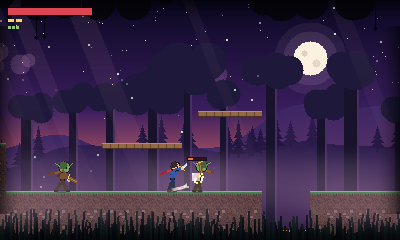

# ge — a small 2.5D action-platformer engine (desktop + Nintendo 3DS)

A C99 engine for side-scrolling games with **sprite animation**, **fast frame-based combat** and **layered, atmospheric backgrounds**, built so the same game code runs on a desktop window and on a 3DS.



*The included demo, "Gloamwood" (every pixel is generated in code — no art files). The 3-hit combo, hit-flash, sparks, parallax forest, mist and fireflies are all engine features.*

## Quick start

```sh
cmake -S . -B build && cmake --build build -j
./build/demo                 # windowed demo (needs SDL2)
./build/demo --autoplay      # let the scripted player play the level
./build/engine_tests         # 49 checks, no window needed
./build/demo_headless --autoplay --frames 1800 --dump-every 150 --dump-dir shots   # PNG screenshots, no display
```

| Action | Keyboard | 3DS |
|---|---|---|
| Move | ←/→ or A/D | D-pad / Circle Pad |
| Jump (hold = higher) | Z / Space | B |
| Attack (tap again to chain a 3-hit combo) | X / J | Y |
| Dash (invulnerable) | C / K | A |
| Step to back / front lane | Q / E | L / R |
| Drop through a one-way platform | ↓ + Jump | ↓ + B |
| F12 saves `screenshot.png` · Esc quits | | Select quits |

## How it's put together

```
 your game (demo/)  ── fills GeIntent, spawns entities, draws HUD
        │
 engine/  ge_world   tilemap · parallax layers · lanes · camera · particles
          ge_actor   platformer controller + combat resolution
          ge_anim    sprite sheets · clips · frame data (hitboxes)
          ge_gfx     software renderer → one 400×240 framebuffer
          ge_engine  fixed 60 Hz loop
        │
 platform/  sdl2.c │ n3ds.c │ null.c    ← the only 6 functions a port implements
```

The renderer works at **400×240 — the 3DS top-screen resolution**. A desktop build scales that up; the 3DS build copies it to the screen unchanged. Porting to another system means writing one file that implements `ge_platform.h`.

> **Analogy:** the engine core is a *record player's mechanism* and each `platform/*.c` is a *different power plug adapter*. The turntable never changes; you only swap the plug for the wall you're in.

### Sprite animation

Animations are authored as text (see `demo/art.c` for a full example):

```
cell 32 32                 # cell size in the sheet
origin 16 31               # the pixel that sits on the character's feet
clip run loop
  frame 2 5                # frame <cell> <ticks>   (60 ticks = 1 second)
  frame 3 5
clip slash once dmg=8 kb=2.2,-1.5 stop=4 stun=16 cancel=2 next=slash2 lunge=1.6
  frame 8 3                # startup   - harmless
  frame 9 3 hit=2,-31,29,24# active    - hitbox x,y,w,h relative to the feet, facing right
  frame 10 6               # recovery  - harmless again
```

> **Analogy:** a clip is a *film strip with sticky notes*. Each frame of film says which picture to show and for how long; the sticky note on a frame says "the sword is dangerous *here*".

The hitbox lives on the frame, so attack timing is *frame data*, exactly how fighting games are tuned: change a number, the move gets faster or riskier. `ge_image_load_pam()` loads your own sheets (Netpbm P7 RGB_ALPHA — exportable from GIMP/ImageMagick with no decoder dependency).

### Combat

* **Hit-stop** (`stop=`): both fighters freeze for a few ticks on impact — the "crunch" feel. *(Analogy: a held breath at the moment of contact.)*
* **Combos**: press attack again from the clip's `cancel=` frame to jump to `next=`; the 3-hit chain is just three clips linked by name.
* **One hit per swing**: each swing remembers who it hit, so a hitbox that stays active for several frames can't multi-hit.
* **Knockback, hit-stun, invulnerability frames, screen shake, sparks, hit-flash** are built in; the game sees `GE_EV_HIT / GE_EV_KILL / GE_EV_FELL` through `world.on_event`.
* The player and enemies share one code path: both just fill a `GeIntent` (move, jump, attack…). The enemy AI in `demo/main.c` is ~40 lines.

### 2.5D

Physics is classic 2D tiles (solid blocks, one-way platforms, coyote time, jump buffering, variable jump height). Depth comes from two things:

* **Parallax layers** — any number of background/foreground images scrolling at different speeds (`factor_x`; `>1` passes *in front of* the action). Layers can drift on their own (clouds, mist) or be additive (light shafts). *(Analogy: looking out of a train window — distant mountains crawl, nearby trees whip past.)*
* **Depth lanes** — every entity stands in the back (-1), middle (0) or front (+1) lane. Lanes get a perspective offset and a cooler shade, and **attacks only connect within the same lane**, so you can hop lanes to dodge, and enemies hop lanes to chase you. *(Analogy: swimming-pool lanes — you can see the swimmer next to you but you can't tag them without switching lanes.)*

## Nintendo 3DS

```sh
# install devkitPro with the 3ds-dev group, then:
export DEVKITPRO=/opt/devkitpro DEVKITARM=/opt/devkitpro/devkitARM
cd 3ds && make          # → gloamwood.3dsx  (Homebrew Launcher, Citra/Lime3DS)
```

**Status — please read:** the 3DS backend (`platform/n3ds.c`) and `3ds/Makefile` are written but **have not been built against real devkitPro or run on hardware/emulator** — devkitPro could not be installed in the environment this was developed in. The backend source type-checks against a stub of the libctru calls it uses, nothing more. Expect small fixes on first build. Everything else (all engine code, the demo, the tests) is verified on desktop.

Performance on the console is also **unmeasured**. The engine is a CPU software renderer; on desktop the demo spends essentially all its time in blending (~200k blended pixels/frame at full detail, ~120k with `world.low_detail`). That should be comfortable on a New 3DS but may be tight on the original 268 MHz model, which is why the demo switches `low_detail` on automatically there (drops mist, light shafts, cloud and vignette layers). If it isn't fast enough, the next step is a GPU path (citro2d) behind the same `GeImage`/layer API.

## Layout

```
engine/include/ge/   public headers      engine/src/   implementation
platform/            sdl2.c · n3ds.c · null.c (headless, scripted input, PNG dumps)
demo/                the sample game: art.c (procedural sprites + backdrop), level.c, main.c (AI, HUD)
tests/               parser, animation timing, tile physics, one-way platforms, combat rules,
                     lanes, combos, determinism, fixed-timestep loop
3ds/Makefile         devkitPro build
```

The simulation is deterministic (fixed 60 Hz step, seeded RNG), which makes bugs reproducible and replays possible — the headless demo prints a frame checksum you can diff between builds.

## Not there yet

Audio · text/fonts (the HUD is bars and pips) · the 3DS bottom screen and stereoscopic 3D · a level/animation editor (levels are code or ASCII via `ge_tilemap_from_ascii`) · slopes · gamepad remapping · the GPU renderer mentioned above.
